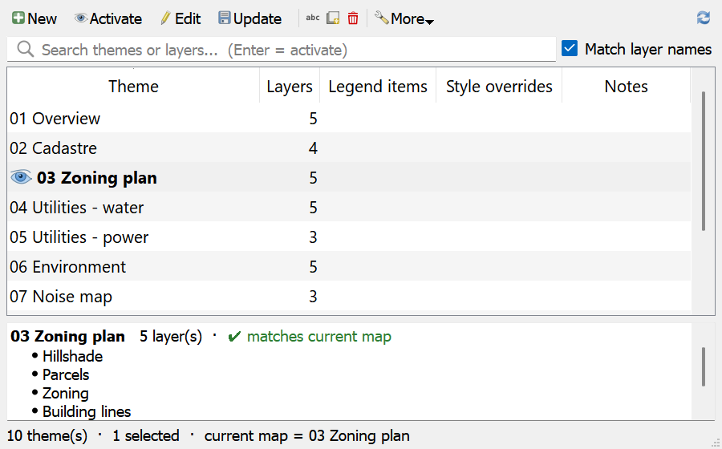
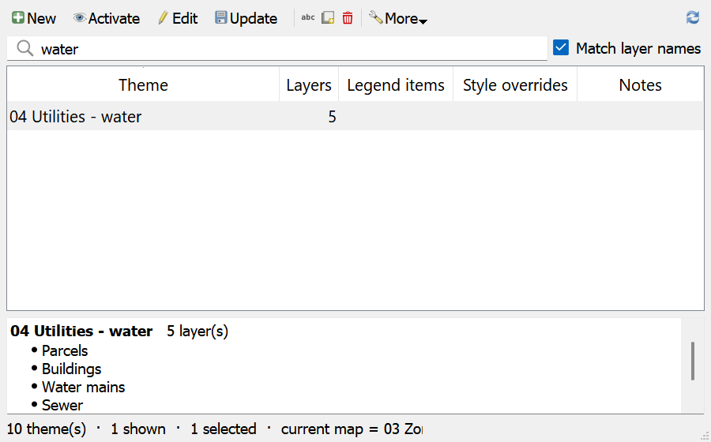
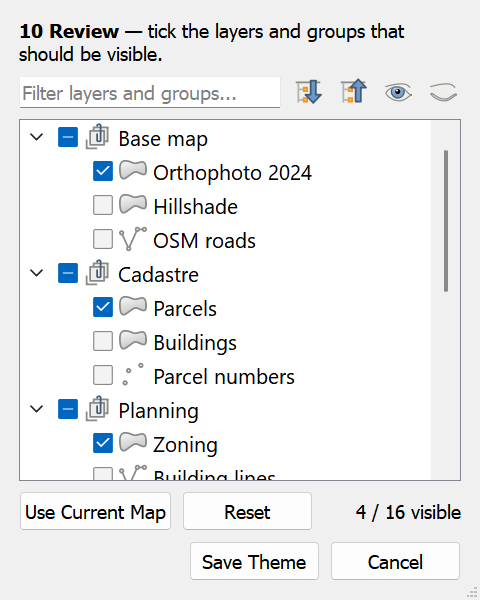
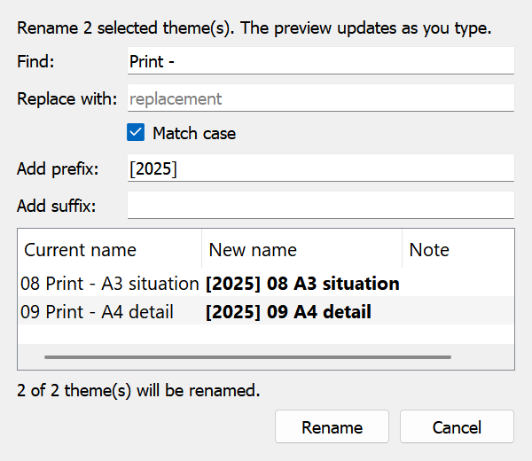
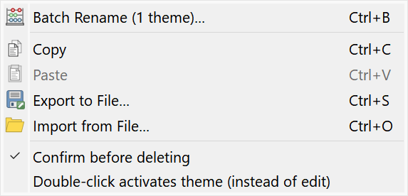

# Layer Theme Manager for QGIS

A fast, friendly manager for QGIS **map themes** (layer visibility presets):
create, activate, edit, rename, duplicate, batch rename, delete, import/export
and copy/paste themes, all from one window.

## Highlights

- **Fast.** The theme list is built in a single pass. Refreshing 300 themes
  with 60 layers takes about **0.02 s** (version 1.0 took about 33 s).
  Theme visibility is computed directly from the theme records, without
  cloning the layer tree.
- **Always up to date.** The list follows changes to themes, layers, the
  layer tree and the project automatically. It only does this while the window
  is visible, and a hidden window refreshes when it is shown again.
- **Knows the current map.** Themes that match the current layer visibility
  are shown in bold with an eye icon, and the status bar names them.
- **Search themes and layers.** Type part of a theme *or* layer name. When
  only one theme matches, Enter activates it.
- **Details panel.** Lists the layers of the selected theme in layer-tree order.
- **Remembers its windows.** Window size and position are saved together with
  the monitor and its resolution. If that monitor is gone or its resolution
  changed, the window is moved proportionally and kept fully visible. It also
  reacts when monitors are connected, disconnected or resized while it is open.

### Search by layer name

### Theme editor

Tick the layers and groups that should be visible. The editor has a filter,
layer icons, expand/collapse, check/uncheck all, *Use Current Map* and *Reset*,
plus a live counter of visible layers. Partially checked groups are saved
correctly, so their visible children stay visible.

### Batch rename

Find/replace, prefix and suffix with a live preview. Name clashes are resolved
automatically, and swaps such as `A → B, B → A` are safe.

### More menu

Clipboard, JSON import/export and options. *Paste* is only enabled when the
clipboard holds copied themes.

## Keyboard shortcuts

| Action | Shortcut |
|---|---|
| Activate selected theme | Enter (in the list or the search box) |
| New theme from current map | Ctrl+N |
| Edit theme | Ctrl+E |
| Update theme from current map | Ctrl+U |
| Rename | F2 |
| Duplicate | Ctrl+D |
| Delete | Del |
| Batch rename | Ctrl+B |
| Copy / Paste themes | Ctrl+C / Ctrl+V |
| Export / Import JSON | Ctrl+S / Ctrl+O |
| Refresh | F5 |

The list also has a right-click context menu. Double-click opens the editor;
under *More*, you can switch double-click to activate the theme instead.

## Installation

### From ZIP (recommended)

1. Download `LayerThemeManager-<version>.zip` from the
   [latest release](https://github.com/danzig666/qgis-layer-theme-manager/releases/latest).
2. In QGIS open **Plugins → Manage and Install Plugins → Install from ZIP**,
   choose the file and click **Install Plugin**.
3. Open it from **Plugins → Layer Theme Manager** or with the toolbar button.

### Manually

Copy the plugin files into a folder named `LayerThemeManager` in your profile's
plugin directory, then restart QGIS and enable the plugin:

- Windows: `%APPDATA%\QGIS\QGIS3\profiles\default\python\plugins\`
- Linux: `~/.local/share/QGIS/QGIS3/profiles/default/python/plugins/`
- macOS: `~/Library/Application Support/QGIS/QGIS3/profiles/default/python/plugins/`

## JSON import/export

Themes are exported as JSON together with each layer's name, source and file
name. On import, layers are matched by ID first, then by name, full source and
finally source file name. This lets themes move between projects. The import
report lists re-linked and unmatched layers.

## Compatibility

- QGIS 3.x and QGIS 4.x (PyQt5 and PyQt6). The code only uses `qgis.PyQt`
  imports, and the enum handling works with both.
- Tested headless on QGIS 3.40.8 (Qt5) and QGIS 4.2.2 (Qt6).
- `renameMapTheme()` is used when available, with a fallback for older QGIS 3.

## Known limitations

- The editor focuses on layer and group visibility. It keeps the style and
  legend-item settings of layers that stay in the theme. Layers newly added
  through the editor use their current defaults.
- Expanded/collapsed state is preserved where the QGIS API exposes it, but it
  cannot be edited.

## License

GNU General Public License v2.0 or later. See [LICENSE](LICENSE).
